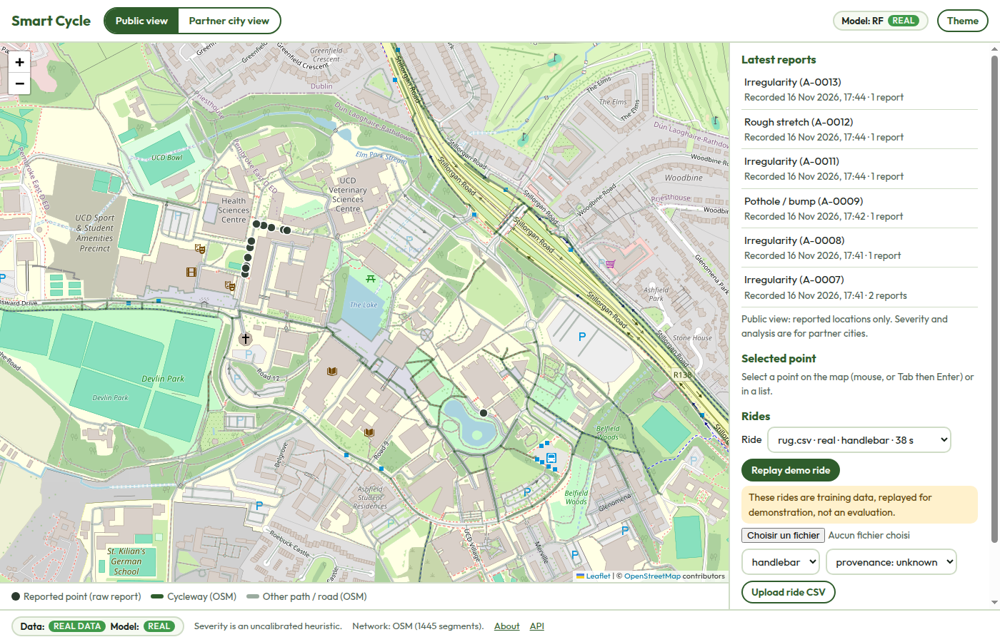

<!-- GENERATED by `python -m smartcycle report` from docs/src/README.md.in; numbers come from the artifacts. Edit the template, not this file. -->

# Smart Cycle — MVP

Smart Cycle turns a smartphone on a bicycle into a road-quality sensor: the accelerometer and
GPS of a ride are classified second by second into **Smooth / Rough / Pothole / Irregularity**,
and the detected anomalies are snapped onto the OpenStreetMap cycleway network. A dashboard
shows the raw reports to the public and a severity / segment analysis to partner cities.



> **Results status:** the final model is trained on **real** data (model card
> `data_provenance = real`): 4 short handlebar rides from
> one session (4.5 min including the pocket ride). Blocked-CV macro-F1 RF
> 0.778 vs rule baseline 0.739 — optimistic,
> see [docs/RESULTS.md](docs/RESULTS.md). Severity is an **uncalibrated heuristic**.

## The three promised results, mapped to the code

| Promised result (deck, "Expected Results") | Where | Entry points |
|---|---|---|
| **Trained Road Anomaly Classifier** | `smartcycle/models/` (rule baseline, RandomForest, HistGradientBoosting, blocked / ride-grouped CV, event metrics, model card) + `smartcycle/features/` | `train`, `evaluate`, `predict`, `models/model_card.json`, `reports/metrics.json` |
| **Functional Smartphone Data Pipeline** | `smartcycle/io/` (Phyphox / plan / canonical loaders, alias table), `smartcycle/features/` (resampling, gravity removal, 1 s windows, features), `smartcycle/pipeline.py`, `smartcycle/api/` (FastAPI + SQLite) | `normalize`, `ingest`, `serve`, `POST /api/rides/upload-csv` |
| **Map-Matching & GPS Alignment** | `smartcycle/geo/` (OSM fetch, Viterbi map matching, events, severity, coverage) | `fetch-osm`, `ingest`, `GET /api/events`, `/api/partner/*` |

## Quick start (fresh clone, committed REAL model, ~2 min)

```bash
python3 -m venv .venv && . .venv/bin/activate
pip install -e '.[dev]'      # scikit-learn pinned (pyproject.toml) to the version that saved the model
pytest -q                    # test suite (~6 min), plain `pytest` from the repo root
python -m smartcycle ingest --dir data/real_public --db data/smartcycle_demo.db
SMARTCYCLE_DB=data/smartcycle_demo.db SMARTCYCLE_ALLOW_DEMO_KEY=1 python -m smartcycle serve
python -m smartcycle predict data/real_public/rides/bump.csv   # in-sample demo, not an evaluation
```

Open <http://127.0.0.1:8000/> (API docs: `/docs`). The final **real** model
(`models/model.joblib`, rf, data_provenance `real`) is committed, so
nothing needs training. The replayed rides are its training rides (the dashboard says so).
`pytest -q` runs the test suite (synthetic fixtures + the committed artifacts); it works the
same as `python -m pytest -q` (`pythonpath` is set in `pyproject.toml`, tested).

**Partner key.** A writable server refuses to start with the default key `demo-partner`
unless `SMARTCYCLE_ALLOW_DEMO_KEY=1` (local demo only, as above). Anywhere else set
`PARTNER_KEY=<secret>`, or run read-only (`SMARTCYCLE_READONLY=1`): the read-only public demo
shows the hint "demo partner key: demo-partner" in the partner prompt, since nothing can be
changed there. The key is never pre-filled or sent automatically by the dashboard.

Synthetic sandbox (everything labelled SYNTHETIC; never overwrites the committed real
artifacts in `models/` and `reports/`: outputs go to `models/synthetic/` and
`reports/synthetic/`, tested):

```bash
python -m smartcycle synth --out data/synthetic --rides 12 --seed 0
python -m smartcycle train --data-dir data/synthetic     # -> models/synthetic/, reports/synthetic/
SMARTCYCLE_NETWORK=data/synthetic/routes.geojson python -m smartcycle ingest --dir data/synthetic --model models/synthetic/model.joblib --db data/smartcycle.db
SMARTCYCLE_NETWORK=data/synthetic/routes.geojson SMARTCYCLE_MODEL=models/synthetic/model.joblib SMARTCYCLE_DB=data/smartcycle.db SMARTCYCLE_ALLOW_DEMO_KEY=1 python -m smartcycle serve
```

Docker (read-only public demo on the committed real data and model, Render env vars):
[docs/DEPLOY.md](docs/DEPLOY.md).

## Reproduce the real results

The 5 real rides are committed in `data/real_public/` (canonical CSVs, labels, start times;
CC BY 4.0, see [docs/DATA.md](docs/DATA.md)). From a fresh clone:

```bash
python -m smartcycle validate-labels --data-dir data/real_public
python -m smartcycle train --data-dir data/real_public --mount handlebar --cv blocked --no-speed --ablate --final-model rf --reports /tmp/repro/reports --out /tmp/repro/models
python -m smartcycle ingest --dir data/real_public --model /tmp/repro/models/model.joblib --db data/smartcycle_real.db
SMARTCYCLE_MODEL=/tmp/repro/models/model.joblib SMARTCYCLE_REPORTS=/tmp/repro/reports python -m smartcycle serve   # http://127.0.0.1:8000/
```

`/tmp/repro/reports/metrics.json` equals the committed `reports/metrics.json` and the model card
differs only in `trained_at`, `git_commit`, `git_dirty` and `data_dir` (checked on 18 Nov 2026,
scikit-learn 1.9.1; seed 0). Drop `--reports/--out` to overwrite the committed
artifacts instead. If the committed model cannot be loaded (other scikit-learn version, corrupt
file), the API keeps running and `/api/health` / `/api/model` report `loaded: false` with the
hint "retrain with the Reproduce command": run the `train` line above without `--out`.
`SMARTCYCLE_READONLY=1 python -m smartcycle serve` gives the read-only public demo (no upload,
photo, detail or delete). `data/real_public/MANIFEST.json` declares the provenance `real`:
a data directory without a manifest is `unknown` and `train` / `evaluate` refuse it unless
`--provenance` is given (synthetic data can never be declared real).

## Running on new real data

**Which one do I need?**
- **A**: you have a new Phyphox ride and want the anomalies it contains on the map. No labels, no training.
- **B**: you have labelled new rides and want a new model (and new metrics).

Both run **locally only**: the Render demo is read-only (`SMARTCYCLE_READONLY=1`, every write
returns 403), so nothing can be ingested or trained there. The examples use `data/new/` and
`data/smartcycle_test.db` so that `data/raw/`, `data/real_public/` and the real DB
`data/smartcycle_real.db` are never touched (`data/new/`, `models/new/`, `reports/new/` and `*.db`
are git-ignored).

### Workflow A — Detect events on a new ride with the existing model

`ingest` is the command that applies the model (`--model`, default `$SMARTCYCLE_MODEL` or
`models/model.joblib`) to every 1 s window, merges the predicted windows into events, map-matches
them and stores the ride + events in the database. `predict` applies the same model and prints the
windows and events (`--out` writes the window predictions to a CSV) but stores nothing. **Neither
reads labels**: no `labels.csv` is needed, and a `label` column in the CSV is ignored.

1. Put the Phyphox export folder (or .zip) in `data/new/rides/<ride_id>/` and create
   `data/new/rides.csv` with `ride_id,file,mount,device,notes` and
   `file = canonical/<ride_id>.csv` (`mount` = `handlebar` or `pocket`).
2. `python -m smartcycle inspect data/new/rides/<ride_id>` (column mapping, sampling rate, GPS, gravity).
3. `python -m smartcycle normalize data/new/rides/<ride_id> --out data/new/canonical/<ride_id>.csv`
4. Optional quick look, nothing stored:
   `python -m smartcycle predict data/new/canonical/<ride_id>.csv --out data/new/<ride_id>_windows.csv`
5. Only if the ride is outside the committed network (UCD campus, `data/osm/cycleways.geojson`):
   `python -m smartcycle fetch-osm --tracks data/new/canonical --out data/new/cycleways.geojson`
   (Overpass download; an existing `--out` file is reused unless `--force`. Do not pass `--force`
   on the committed file). Without a network the rides are stored with `matched=false`.
6. `python -m smartcycle ingest --dir data/new --provenance real --db data/smartcycle_test.db`
   (add `--network data/new/cycleways.geojson` if you did step 5). `--dir` reads `rides.csv` and
   takes the recording time from `data/new/rides/<ride_id>/meta/time.csv`. Without `rides.csv`,
   `--dir` would ingest every CSV under the folder, including the raw Phyphox files, so in that case pass
   the canonical file instead: `ingest data/new/canonical/<ride_id>.csv --provenance real --db
   data/smartcycle_test.db [--started-at 2026-11-16T17:20:00]`. `--provenance real` is needed
   because `data/new/` has no `MANIFEST.json` (otherwise the ride is stored as `unknown`).
7. `SMARTCYCLE_ALLOW_DEMO_KEY=1 python -m smartcycle serve --db data/smartcycle_test.db` (add
   `SMARTCYCLE_NETWORK=data/new/cycleways.geojson` if you did step 5). Always pass `--db`: without it,
   `serve` opens `data/smartcycle_real.db` when that file exists.

**Not validated.** The committed model was trained on one iPhone, in one session, on 4 short
handlebar rides on campus. Predictions on other phones, mounts (pocket, bag) or roads are
unvalidated, and the severity is an uncalibrated heuristic.
**Privacy.** New rides contain the raw GPS trace of the person who recorded them: get their
consent before sharing them, and never commit `data/new/` (it is git-ignored).

### Workflow B — Train a new model with new labelled data

1. Place the exports and `rides.csv` in `data/new/` as in A step 1, and add
   `data/new/MANIFEST.json` with `{"provenance": "real"}` (or pass `--provenance real` to
   `train`: a directory with an unknown provenance is refused).
2. `python -m smartcycle inspect data/new/rides/<ride_id>`
3. `python -m smartcycle normalize data/new/rides/<ride_id> --out data/new/canonical/<ride_id>.csv`
4. Label with `web/label.html` (open the file in a browser, load the canonical CSV, export
   `labels_<ride_id>.csv`), merge into `data/new/labels.csv` (`ride_id,t_start_s,t_end_s,label`;
   labels `Smooth`, `Rough`, `Pothole`, `Irregularity` only).
5. `python -m smartcycle validate-labels --data-dir data/new`
6. `python -m smartcycle train --data-dir data/new --mount handlebar --cv blocked --no-speed --ablate --final-model rf --out models/new --reports reports/new`

   > **Warning:** without `--out` / `--reports`, `train` on real (or mixed) data writes
   > `models/model.joblib`, `models/model_card.json` and `reports/`, **overwriting the committed
   > model and metrics**. Only synthetic data defaults to `models/synthetic/` and `reports/synthetic/`.
7. Try the new model: `python -m smartcycle ingest --dir data/new --provenance real --model models/new/model.joblib --db data/smartcycle_test.db`,
   then `SMARTCYCLE_MODEL=models/new/model.joblib SMARTCYCLE_REPORTS=reports/new SMARTCYCLE_ALLOW_DEMO_KEY=1 python -m smartcycle serve --db data/smartcycle_test.db`.
8. New training changes the metrics. `report` always reads `models/model_card.json` and
   `reports/metrics.json`, so a model in `models/new/` is not shown in the docs. To make it the
   official model, re-run step 6 without `--out` / `--reports` (this overwrites the committed
   artifacts on purpose), then run `python -m smartcycle report --data-dir data/new` to regenerate
   `docs/RESULTS.md`, this README and the other generated docs. Check them with `report --check`.

**Privacy.** New rides contain the raw GPS trace of the person who recorded them: get their
consent before sharing them, and never commit `data/new/` (it is git-ignored).

## Layout

```
smartcycle/            python package
  io/                  loaders (canonical, plan-style, Phyphox folder/zip), column aliases
  synth/               synthetic ride generator (+ calibrated variant)
  features/            preprocessing, windows, features, augmentation
  models/              rule baseline, RF, HGB, CV, evaluation, reports, model card
  geo/                 OSM fetch, map matching, events, severity (heuristic)
  api/                 FastAPI app, SQLite DB, photo handling
  report/              docs generated from the artifacts (`report`)
  pipeline.py          one ride -> events, coverage, track
  cli.py               `python -m smartcycle <command>`
web/                   index.html (dashboard), label.html (labelling tool), site/ (marketing page)
data/                  osm/ real_public/ (committed), raw/ synthetic/ photos/ (gitignored)
models/ reports/       committed artifacts of the final REAL model
docs/                  RESULTS, DATA, ARCHITECTURE, DEMO, MAPPING_TO_PLAN, WALKTHROUGH, ...
tests/                 pytest (synthetic fixtures) + tests/js (label tool)
```

CLI: `synth · inspect · normalize · validate-labels · train · evaluate · predict · fetch-osm ·
ingest · serve · report` (`python -m smartcycle <command> -h`).

## Privacy / GDPR measures (implemented)

- No accounts; rides carry a random anonymous device id (`anon-<hex>`), never returned by list
  endpoints.
- `DELETE /api/rides/{handle}` deletes a ride, its coverage, its track and the events only it
  reported (with their photos). It needs the `X-Delete-Token` returned once at upload for that
  ride (the dashboard keeps it in `sessionStorage` of the uploading tab) or the partner key;
  the same token is needed to add a detail or a photo to the ride's events. Rides ingested by
  the CLI have no token (partner key only).
- Photos: JPEG/PNG only, ≤ 5 MB, verified with Pillow and re-encoded from pixels, so all EXIF
  (including GPS) is dropped; random file names; the UI warns not to photograph people or
  number plates.
- The public view shows type, location, date and number of reports only. Public JSON is an
  allow-list (tested): no severity, confidence, ride_id, device_id, raw GPS, ride start time
  (date only), uploaded file name or processing summary; rides are addressed by a random
  16-hex public handle and their public track keeps only map-matched (snapped) points.
- Photos are visible to **partner cities only** (they may show people or number plates despite
  the warning); the public view never links them.
- The 5 real rides are published in `data/real_public/` with the recorder's written consent,
  without device metadata. Raw exports, the databases and photos stay out of git
  (`.gitignore`: `data/raw/*`, `data/photos/*`, `*.db`, `*.bak`, `data/demo_rides/*`).
- `SMARTCYCLE_READONLY=1` turns every write endpoint (upload, ride JSON, photo, detail, delete)
  into a 403 for a public deployment.
- Uploads: `.csv` only, ≤ 20 MB; JSON ≤ 40 MB; parameterised SQL; no path traversal in photo
  names. The partner key (`X-Partner-Key`) is a demo-only control, not authentication.

## Limitations

- 4 handlebar rides from one session, 0.318 km evaluated; no real
  potholes (speed bumps are used as a Pothole proxy, 3
  events), no real swerve / braking; blocked CV is optimistic (in-sample
  0.961 vs CV 0.778).
- Pothole and Irregularity are often confused; the pocket test is inconclusive
  (0/1 event).
- Severity 1–5 and segment bands are uncalibrated heuristics.
- Deleting a ride that was the FIRST reporter of a merged event updates the report count and
  severity, but the event keeps that first ride's position, times, peak and photo (documented,
  not fixed in the MVP). Upload size is checked while reading (20 MB), but the multipart
  parser may spool a larger body to a temporary file first: put a size limit in the reverse
  proxy for a writable deployment.
- No phone recorder yet (P04b PWA on hold): rides come from Phyphox CSV exports (upload or CLI).
- Known leftovers: no service worker / offline mode; campus OSM segments are mostly unnamed;
  native file inputs follow the browser language.

Full results and caveats: [docs/RESULTS.md](docs/RESULTS.md). Study guide:
[docs/WALKTHROUGH.md](docs/WALKTHROUGH.md). Demo script: [docs/DEMO.md](docs/DEMO.md).

## Authors and licenses

Paul Emptoz and Gonzalo Adarraga (UCD, "AI for Engineering", 2026).

- Code: MIT ([LICENSE](LICENSE)).
- Real recordings (`data/real_public/`): CC BY 4.0, attribution "Smart Cycle recordings, Paul
  Emptoz and Gonzalo Adarraga, 2026, CC BY 4.0"
  ([data/real_public/DATA_LICENSE.md](data/real_public/DATA_LICENSE.md)).
- Map data © OpenStreetMap contributors (ODbL), independent of the above. Map tiles ©
  OpenStreetMap contributors. Leaflet (BSD-2) is vendored in `web/vendor/leaflet/`.
