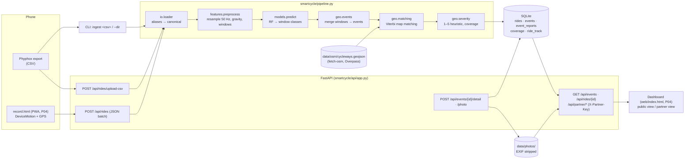

# Architecture (P03)

Everything runs locally with one command (`python -m smartcycle serve`), free and open source.

## Data flow
1. **Input**: a ride CSV (canonical, plan-style or Phyphox-style; alias table) or a JSON batch
   from the phone (`samples [{t,ax,ay,az}]`, `gps [{t,lat,lon,acc,speed}]`, epoch ms). Both end up
   in the canonical DataFrame via `smartcycle.io.loader.canonicalise`.
2. **Classification** (`models.predict.predict_ride`): resampling, gravity removal, 1 s windows,
   features, RandomForest → per-window class; stationary windows never become events.
3. **Events** (`geo.events.merge_events`): Pothole / Irregularity points at the peak window, Rough
   stretches; peak |a_vert|, peak a_hmag and rms(a_vert) carried for severity.
4. **Map matching** (`geo.matching.match_track`): GPS fixes → segments with an HMM-lite Viterbi
   (distance emission, connectivity transitions, cycleway bonus). No network file → everything
   stored with `matched=false`, raw GPS kept.
5. **Severity / coverage** (`geo.severity`): 1–5 from amplitude bins (uncalibrated heuristic);
   metres ridden per segment and metres of Rough → segment score per 100 m and heat band.
6. **Storage** (`api/db.py`): dedup of point events (same type, same segment, ≤ 12 m →
   `reports + 1`, max severity); GDPR delete of a ride.
7. **Views**: public (type, location, date, reports) vs partner (severity, confidence, peak,
   segment, detail, photo, segment scores, alerts, priorities). Provenance (model + data) is in
   every events/partner response.

## Configuration (env)
| Variable | Default | Purpose |
|---|---|---|
| `SMARTCYCLE_NETWORK` | `data/osm/cycleways.geojson` | segment network (use `data/synthetic/routes.geojson` for synthetic rides) |
| `SMARTCYCLE_DB` | `data/smartcycle.db` | SQLite file (gitignored) |
| `SMARTCYCLE_MODEL` | `models/model.joblib` | trained model bundle |
| `SMARTCYCLE_PHOTOS` | `data/photos` | photo storage |
| `PARTNER_KEY` | `demo-partner` | partner view key — **demo-only control, not authentication** |

## Security / privacy basics
CSV ≤ 20 MB (`.csv` only), JSON body ≤ 40 MB, pydantic validation, parameterised SQL, photo
JPEG/PNG ≤ 5 MB verified with Pillow and re-encoded from pixels (all metadata dropped), random
photo names with a strict name pattern (no path traversal), anonymous random device ids (never
returned by list endpoints), `DELETE /api/rides/{id}`.
