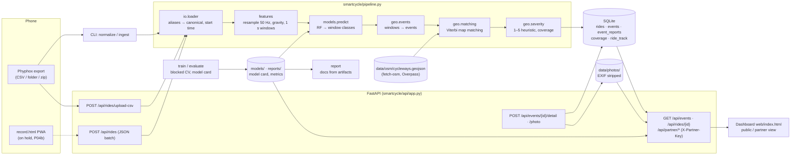

<!-- GENERATED by `python -m smartcycle report` from docs/src/ARCHITECTURE.md.in; numbers come from the artifacts. Edit the template, not this file. -->

# Architecture

Everything runs locally with one command (`python -m smartcycle serve`), free and open source:
Python (numpy, pandas, scipy, scikit-learn, FastAPI), SQLite, vanilla JS + Leaflet, OSM data.

## Data contract

- **Canonical ride CSV**: `timestamp_ms, accel_x, accel_y, accel_z, latitude, longitude,
  gps_accuracy_m, speed_mps, label`. Acceleration in m/s² **including gravity**; `timestamp_ms`
  epoch ms or ride-relative ms; GPS columns empty between fixes; `label` optional.
- Also accepted through the alias table (`smartcycle/io/aliases.py`): plan-style
  (`Timestamp (ms), Accel_X, …, Ground_Truth_Label`) and Phyphox-style (`Time (s)`,
  `Acceleration x (m/s^2)`, `Latitude (°)`, …), a Phyphox folder or .zip (one CSV per sensor).
  A missing column fails with the list of columns found.
- **Recording time**: epoch timestamps, or Phyphox `meta/time.csv` (START system time) for
  relative ones; otherwise the event date is the upload time and the API sets
  `date_kind = "uploaded"` (UI: "Uploaded").
- **Labels**: `Smooth`, `Rough`, `Pothole`, `Irregularity` only; a `label` column or
  `labels.csv` (`ride_id,t_start_s,t_end_s,label`, seconds from the first sample).
- **Sampling rate** is never hardcoded: estimated from the median dt, resampled to
  50 Hz. Windows 1 s, step 0.5 s; windows slower
  than 1 m/s are stationary (never events, excluded from metrics).

## Data flow
1. **Input**: a ride CSV or a JSON batch (`samples [{t,ax,ay,az}]`, `gps [{t,lat,lon,acc,speed}]`,
   epoch ms) → canonical DataFrame (`smartcycle.io.loader.canonicalise`).
2. **Classification** (`models.predict.predict_ride`): resampling, 0.5 Hz gravity estimate,
   orientation-invariant channels (vertical, horizontal magnitude, deviation of |a|),
   47 features per window, RandomForest → class per window.
3. **Events** (`geo.events`): consecutive Pothole / Irregularity windows → one point event at the
   peak; Rough windows → stretches. Peak |a_vert|, peak a_hmag, rms(a_vert) kept for severity.
4. **Map matching** (`geo.matching.match_track`): fixes with accuracy > 30 m dropped, then an
   HMM-lite Viterbi (distance emission, connectivity transitions, cycleway bonus). No network →
   `matched=false`, raw GPS kept.
5. **Severity / coverage** (`geo.severity`, UNCALIBRATED HEURISTIC): 1–5 from fixed bins
   (multiples of g for point events, ISO 2631-1-inspired rms bins for Rough); per segment:
   metres ridden, metres of Rough, score, band Good / Needs attention / Repair soon.
6. **Storage** (`api/db.py`): dedup of point events (same type, same segment, ≤ 12 m →
   `reports + 1`, max severity); GDPR delete of a ride.
7. **Views**: public (type, location, date, reports) vs partner (severity, confidence, peak,
   segment, detail, photo, segment scores, alerts, priorities). Model and data provenance are in
   every events / partner response and on the dashboard banner.

## API

| Method | Path | Purpose |
|---|---|---|
| GET | `/api/health` | status, model loaded, network, provenance |
| GET | `/api/model` | model card, metrics, notes, report images |
| GET | `/api/network` | segment network (GeoJSON) for the map |
| GET | `/reports/{name}` | report PNGs (read-only whitelist) |
| POST | `/api/rides/upload-csv` | upload one ride CSV (≤ 20 MB, `.csv`), run the pipeline |
| POST | `/api/rides` | JSON batch from a phone (≤ 40 MB) |
| GET | `/api/rides` | list rides (no device ids) |
| GET | `/api/rides/{id}` | ride summary, matched track, its events (replay) |
| DELETE | `/api/rides/{id}` | GDPR delete |
| GET | `/api/events?view=public\|partner` | events as GeoJSON (partner needs `X-Partner-Key`) |
| GET | `/api/partner/segments` | per-segment score and band (heuristic) |
| GET | `/api/partner/alerts` | severity ≥ 4 in the last 10 days, top 4 |
| GET | `/api/partner/priorities` | top 5 segments by score |
| POST | `/api/events/{id}/detail` | rider's explanation (reason + text) |
| POST | `/api/events/{id}/photo` | photo (JPEG/PNG ≤ 5 MB, re-encoded, EXIF dropped) |
| GET | `/api/photos/{name}` | stored photo (strict name pattern) |

## Configuration (env)
| Variable | Default | Purpose |
|---|---|---|
| `SMARTCYCLE_NETWORK` | `data/osm/cycleways.geojson` | segment network (`data/synthetic/routes.geojson` for synthetic rides) |
| `SMARTCYCLE_DB` | `data/smartcycle.db` (`serve`: `data/smartcycle_real.db` if it exists) | SQLite file (gitignored) |
| `SMARTCYCLE_MODEL` | `models/model.joblib` | model bundle; its card is read next to it |
| `SMARTCYCLE_REPORTS` | `reports/` (`reports/synthetic/` for a model in `models/synthetic/`) | metrics and figures shown by `/api/model` |
| `SMARTCYCLE_PHOTOS` | `data/photos` | photo storage |
| `PARTNER_KEY` | `demo-partner` | partner view key — **demo-only control, not authentication** |
| `SMARTCYCLE_READONLY` | unset | `1`: public read-only demo, every POST / DELETE answers 403 and the dashboard hides upload / detail / photo (Docker image) |

## Artifacts and docs
`train` writes `models/model.joblib` (gitignored) + `models/model_card.json` and
`reports/metrics.json|md`, figures, `per_ride.csv` (synthetic data: `models/synthetic/`,
`reports/synthetic/`). `report --data-dir data/real_public` adds `reports/insample.json` (saved model on
its own training windows) and `reports/dataset.json`, then generates `docs/RESULTS.md` and the
docs from `docs/src/*.md.in` (double-brace placeholders such as `metrics.models.rf.macro_f1`, read from the artifacts). A test
fails if a committed doc is stale or if `models/model_notes.json` quotes a number that is not in
the artifacts.
